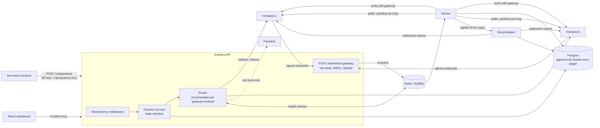

# Multi-Rail Payment Orchestrator & Reconciliation Engine (Nigeria)

A payment layer that sits between a merchant and several payment gateways. It routes each payment to the healthiest gateway **and payment method**, records every movement of money in a double-entry ledger, processes gateway webhooks safely, and reconciles its books against gateway settlement reports.

> **What this is:** a portfolio project that demonstrates backend engineering patterns used in payment systems: idempotency, row-level locking, a double-entry ledger, safe webhook handling, circuit-breaker failover and reconciliation. It also includes a **routing lab**: a simulator that compares seven routing strategies (circuit breakers, Thompson-sampling bandits, a hybrid) across seven Nigerian-style outage scenarios with confidence intervals, and picks the production strategy from the results ([docs/ROUTING-LAB.md](docs/ROUTING-LAB.md)).
>
> Similar products exist (commercial orchestrators, and open-source ones such as Juspay's Hyperswitch). This is a learning build of the hard parts, not a new idea.
>
> **What this is not:** a validated product or a claim about a market gap. It runs in **test mode only**: two mock gateways that I control, plus an optional Paystack adapter that accepts **test keys only** and has not been exercised against Paystack (no keys were available). No real money moves.

## Why these patterns

Two facts shape the design:

- **NIBSS outages are real** and hit bank transfers on every gateway at the same time, while cards keep working. So health and failover are tracked **per gateway *and* per payment method**, not per gateway. Failures are also tracked **per customer bank**, with each failure attributed to the gateway or the bank, so one bank's bad day doesn't cut off a gateway for everyone else.
- **Webhooks can be resent with identical payloads, and delivery is not guaranteed.** So webhook handling is idempotent, there is a polling fallback using the gateway's verify API, and a reconciliation job independently checks the books.

## Architecture



Details: [docs/ARCHITECTURE.md](docs/ARCHITECTURE.md) · Decisions: [docs/DECISIONS.md](docs/DECISIONS.md) · Code tour: [docs/WALKTHROUGH.md](docs/WALKTHROUGH.md) · What I learned: [docs/LEARNING.md](docs/LEARNING.md)

## Run it locally (Windows / PowerShell)

Prerequisites: Node 20.19+ (tested on 26), pnpm (tested on 12.11), Docker Desktop running.

Run these from the repo root:

```powershell
pnpm run setup
```
This creates `.env` with freshly generated secrets, installs dependencies, starts Postgres and Redis, runs migrations and seeds a demo merchant. Use `pnpm run setup`, not `pnpm setup`: `setup` is also a built-in pnpm command.

```powershell
pnpm dev
```
This starts the API (:4000), the worker, mockpay-a (:4101), mockpay-b (:4102) and the dashboard (:5173). Open http://localhost:5173 and sign in with `ADMIN_API_KEY` from `.env`.

### Demo steps

```powershell
pnpm demo
```
A scripted tour of every pattern: normal payment, duplicate webhooks, gateway failover, NIBSS-style outage, dropped webhook recovered by polling, reconciliation catching a tampered settlement, ledger check. It uses its own scratch database, so it works with or without `pnpm dev` running.

```powershell
pnpm demo:concurrency
```
50 simultaneous withdrawals against a balance that covers 10, comparing the naive and the safe endpoint.

```powershell
pnpm lab
```
Runs the routing lab (about 2 minutes): 7 strategies x 7 outage scenarios x 8 seeds. Writes [docs/ROUTING-LAB.md](docs/ROUTING-LAB.md) and the data behind the dashboard's **Routing Lab** page.

**In the dashboard:** open **Routing Lab** to see the strategy comparison charts. Then open **Simulator** and click **mockpay-a down**, then **Send 10 payments**. Watch the mockpay-a card route turn *degraded* and traffic move to mockpay-b. Try **NIBSS outage** with method *bank transfer*, then *card*. Try **GTBank down on mockpay-a** and send bank transfers from GTBank: only that bank's route is cut off (see the bank-level table on **Gateway Health**). Open **Reconciliation** and press **Import settlements & run now**.

### Tests

```powershell
pnpm test
```
Unit and integration tests run against real Postgres and Redis, with both mock gateways running in-process.

```powershell
pnpm lint
```
```powershell
pnpm typecheck
```

## Deploying

Dashboard on Vercel, backend (API + worker + mock gateways in one container) on Railway: step-by-step in [DEPLOY.md](DEPLOY.md).

## Public demo mode

Set `PUBLIC_DEMO=true` (with `ENABLE_NAIVE_ENDPOINTS=false`) to turn the dashboard into a shared, self-resetting sandbox that anyone can try without a key:

- The sign-in page shows **Try the live demo**. Visitors get a temporary session (a random token stored in Redis, 2-hour expiry), never the owner's admin key.
- Demo sessions can read every page, break and fix the mock gateways, send test payments, and run the poller and reconciliation. Anything else (uploading settlement files, resolving discrepancies, any future admin action) is **refused by the server** (403), via an allow-list.
- Limits: at most 20 payments per click, 200 per visitor per hour, 3,000 for all visitors per hour, 60 changes per visitor per minute, 20 new sessions per IP per hour.
- Every hour (`DEMO_RESET_INTERVAL_MS`) the worker wipes and reseeds the sandbox: mock gateways reset and emptied, all tables truncated, routing health cleared, demo merchant reseeded. **This deletes all data, so only use demo mode on a database that holds nothing else.**
- A banner tells visitors it is a shared test-mode sandbox and when it resets.
- Behind a hosting proxy, set `TRUST_PROXY=1` so the per-IP limit sees real client addresses.

## Verified results

| Check | Result |
|---|---|
| `pnpm test` | 102 tests passing (shared 6, dashboard 4, mock gateway 7, routing + lab 17, API 68) |
| `pnpm demo` | 8/8 scenarios pass (including bank-level health) |
| `pnpm lab` | bank-aware breaker 97.75% vs gateway-only 94.10% success when one bank fails everywhere; hybrid matches the best success rate in every scenario with the lowest fees (simulation, illustrative parameters) |
| `pnpm demo:concurrency` | naive: 31 of 50 withdrawals succeeded, balance **−NGN 21,000**; safe: exactly 10, balance NGN 0; one key reused 50 times: 1 withdrawal |
| Dashboard | every page checked in a browser; live failover visible on the Simulator page |

The naive run varies with machine timing; the safe run is deterministic.

## API at a glance

| Endpoint | Auth | Notes |
|---|---|---|
| `POST /v1/payments` | merchant key + `Idempotency-Key` | optional `bankCode` enables bank-level routing. 201 pending · 402 every gateway failed · 503 method (or bank) unavailable everywhere, suggesting an alternative |
| `GET /v1/payments/:id` | merchant key | scoped to the calling merchant |
| `POST /v1/withdrawals` | merchant key + `Idempotency-Key` | locked, safe |
| `POST /v1/withdrawals/naive` | merchant key | **deliberately unsafe** teaching endpoint, refused in production |
| `GET /v1/balance` | merchant key | derived from ledger postings |
| `POST /webhooks/:gateway` | HMAC signature | raw body, dedupe, enqueue, fast 200 |
| `/admin/*` | `X-Admin-Key` | overview, payments, webhooks, ledger, routing health, reconciliation, simulator |
| `GET /health` | none | database + Redis check |

## Security notes

- Money is integer kobo (`BIGINT`), never floats.
- Ledger rules live in Postgres too: deferred triggers reject unbalanced entries, and `UPDATE`/`DELETE` on postings and journal entries is blocked.
- Merchant API keys are stored as SHA-256 hashes. Admin, control and signature comparisons are constant-time.
- Webhooks are verified with HMAC-SHA512 over the raw bytes, and the worker re-verifies every outcome with the gateway API before moving money.
- Zod validates every input and every environment variable. Startup is refused with a placeholder secret, a live Paystack key, or the naive endpoint enabled in production.
- helmet, strict CORS, body-size limits, per-IP and per-merchant rate limits, and pino log redaction of credentials and signatures.
- Docker and mock-gateway ports bind to `127.0.0.1` only.

### Known limitations (honest list)

- **Routing-lab numbers come from a simulator with illustrative parameters**, not real gateway, bank or NIBSS data. They compare strategies under the same assumptions; they don't predict real success rates.
- **A payment's `bankCode` is used for routing but not yet stored on the payment record** (adding the column is a small migration).
- **The hybrid router reacts more slowly to slow degradations** than the plain breaker (about 9 vs 1.5 simulated minutes). Set `ROUTING_STRATEGY=breaker` if that matters more than fees.

- **Admin auth is one shared key** held in the browser's session storage. A real system needs per-user accounts, roles, SSO and an audit log.
- **Rate limits are in-memory per process.** Several API instances would need a Redis-backed store.
- **Health tracking does read-then-write in Redis** without a Lua script, so two simultaneous results can race. In the worst case a route trips one call late; money is never affected.
- **Failover after a timeout can double-charge** if the first gateway actually succeeded. Reconciliation detects this (the same reference settled on two gateways), but there is no automatic refund.
- **Mock settlement is T+0** (settled the moment a charge succeeds). Real gateways settle in batches, days later.
- **Idempotency keys are kept forever.** A production system would expire them (for example after 24 hours) with a cleanup job.
- **No refunds, chargebacks, payouts to banks or multi-currency.** Out of scope.
- **The Paystack adapter is untested against Paystack** and has no settlement import; use the CSV upload for Paystack.
- **The API runs with `tsx`** (TypeScript executed directly) rather than a compiled build. Fine for a demo; a deployment would compile first.

## Tech stack

TypeScript (strict) · Node · Express 5 · PostgreSQL 16 · Prisma 6 (+ raw SQL for locking and ledger reads) · Redis 7 · BullMQ · Zod · pino · Vitest + supertest · autocannon · React 19 + Vite + Tailwind 4 + TanStack Query · hand-built SVG charts · GitHub Actions · pnpm workspaces.

Routing maths: circuit breakers, discounted Thompson sampling with Beta posteriors (Marsaglia-Tsang Gamma sampler), hierarchical gateway x bank model, seeded simulation with common random numbers and Student-t confidence intervals.
