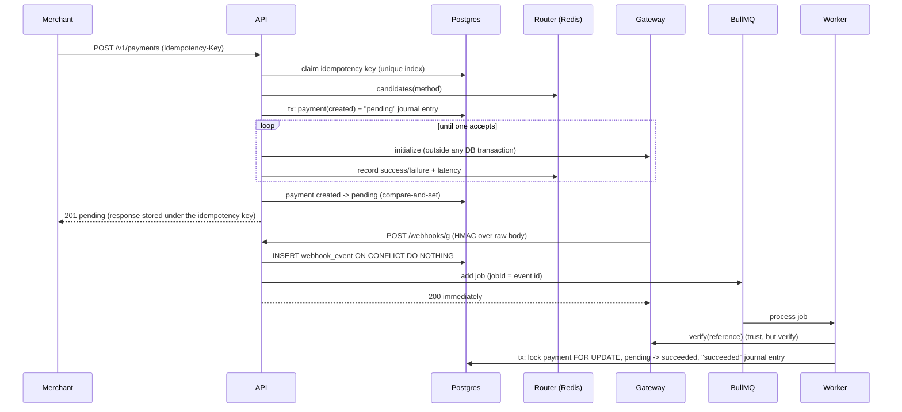
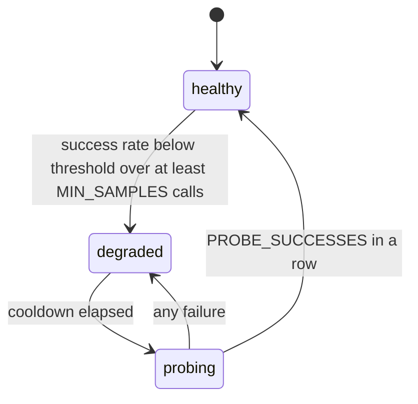

# Architecture

## Processes

| Process | Command | Responsibility |
|---|---|---|
| API | `apps/api/src/server.ts` | Merchant API, admin API, webhook intake. Never does slow work inline. |
| Worker | `apps/api/src/worker.ts` | Processes webhook jobs, runs the poller every `POLL_INTERVAL_MS`, runs nightly reconciliation. |
| mockpay-a / mockpay-b | `apps/mock-gateway/src/server.ts` | Fake gateways with runtime-controllable failures. |
| Dashboard | `apps/dashboard` (Vite) | Admin UI. Talks only to the API, through Vite's `/api` proxy. |
| Postgres 16 | docker compose | Source of truth: payments, ledger, webhooks, idempotency, settlements, reconciliation. |
| Redis 7 | docker compose | BullMQ queues and routing health windows. Losing Redis loses no money data. |

All long-lived dependencies (Prisma, Redis, gateway registry, router, queues) are built once into an `AppContext` (`src/context.ts`) and passed explicitly. Tests and the demo build their own context against other databases and ports.

## Life of a payment

If the webhook never arrives, the poller finds payments pending longer than `PENDING_POLL_AFTER_MS`, calls `verify`, and settles them through the same `settlePayment` function. If it is still pending after `PAYMENT_EXPIRY_MS`, the payment expires and the pending amount is released.

## Ledger

Signed postings: debit = positive, credit = negative. Every journal entry sums to zero and has a unique `reference` (for example `payment:<id>:succeeded`), so the same economic event can never be posted twice.

| Event | Postings |
|---|---|
| Payment created | Dr `payments_pending` A · Cr `merchant_pending` A |
| Payment succeeded | reverse the pending pair · Dr `gateway_clearing:<g>` (A−F) · Dr `gateway_fees:<g>` F · Cr `merchant_balance` (A−P) · Cr `platform_revenue` P |
| Payment failed / expired | reverse the pending pair |
| Withdrawal | Dr `merchant_balance` X · Cr `payouts_clearing` X |

A = amount, F = gateway fee, P = platform fee (`PLATFORM_FEE_BPS`, capped). Balances are always `SUM(postings)` (sign-flipped for credit-normal accounts).

Database enforcement (`prisma/migrations/*_ledger_integrity`):
- `CHECK (amount_kobo <> 0)`
- deferred constraint triggers: each entry has at least 2 postings summing to 0, checked at COMMIT
- `BEFORE UPDATE OR DELETE` triggers on `postings` and `journal_entries` raise `LEDGER_APPEND_ONLY`

## Concurrency control

| Risk | Mechanism |
|---|---|
| Two withdrawals overdraw a balance | `SELECT ... FOR UPDATE` on the merchant's balance account row inside a READ COMMITTED transaction |
| Same request sent twice / concurrently | `UNIQUE (merchant_id, key)` on `idempotency_keys`; claim with `INSERT ... ON CONFLICT DO NOTHING` |
| Webhook and poller settle the same payment | `FOR UPDATE` on the payment row; terminal states are no-ops; unique journal reference |
| Racing status updates | compare-and-set: `UPDATE payments SET status = $to WHERE id = $id AND status = $from` |
| Duplicate webhook | `UNIQUE (gateway, event_id)`, plus BullMQ `jobId` = event id |
| Duplicate withdrawal if idempotency is bypassed | `UNIQUE (merchant_id, idempotency_key)` on `withdrawals` |

## Routing

`HealthAwareRouter` keeps a circuit breaker per (gateway, method) in Redis: a rolling window of the last `ROUTING_WINDOW_SIZE` outcomes, plus a state hash.

Health is tracked at two levels: (gateway, method) and (gateway, method, **bank**). A success counts for both; a failure counts only for the level its error code blames (`bank_unavailable` means bank, anything else means gateway). A route's state is the worst of its levels.

Strategies (`ROUTING_STRATEGY`, rules in `packages/routing`):
- **hybrid** (default): degraded routes excluded and probing placed by the breaker rules; healthy routes ordered by a Thompson draw of P(success) x (amount - fee).
- **breaker**: healthy routes by success rate, then latency (unranked until `MIN_SAMPLES`), probing last, every 5th payment probing first.
- **thompson / thompson_cost**: Thompson sampling over decaying counts, with probes for suspect routes limited by an atomic Redis `SET NX PX` lock.

If nothing is left for a method (and bank), the API answers 503 `METHOD_UNAVAILABLE` and lists the methods that still have a route. The choice of default is justified by simulation in [ROUTING-LAB.md](ROUTING-LAB.md).

Gateway errors are classified (`gateway.types.ts`): timeouts and 5xx count against health and trigger failover; 4xx ("rejected") does neither, because another gateway would refuse the same bad request.

## Reconciliation

`runReconciliation` imports settlements (API pull from the mocks, or CSV upload), then compares settlements in the window against **ledger postings** of succeeded payments. Cross-window lookups are by reference, so midnight boundaries don't create false positives. Discrepancies are recorded for a human to resolve, never auto-fixed. Scheduled by a BullMQ job scheduler (`RECONCILIATION_CRON`, `RECONCILIATION_TZ`) with a 48-hour look-back.

## Configuration

All configuration lives in the root `.env` and is validated by `apps/api/src/lib/env.ts`. See `.env.example` for every variable.
